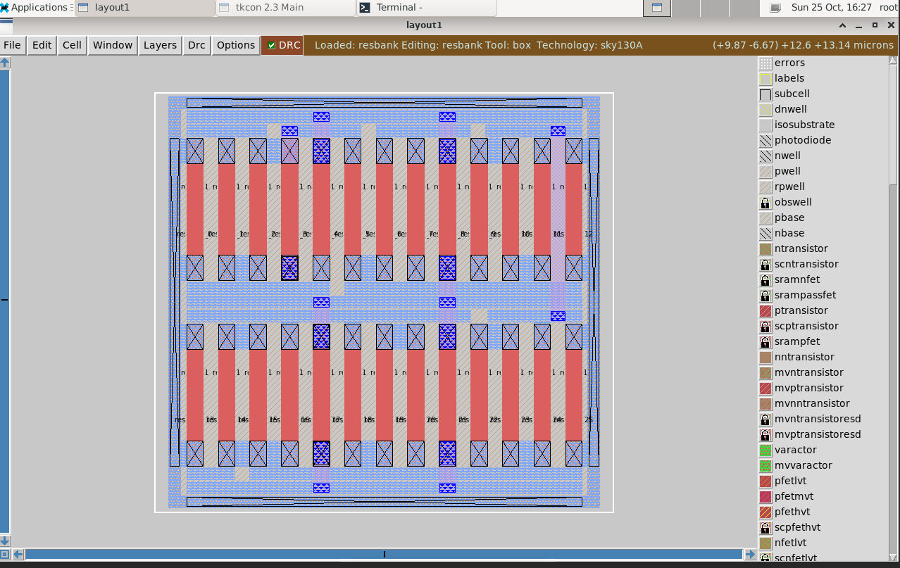
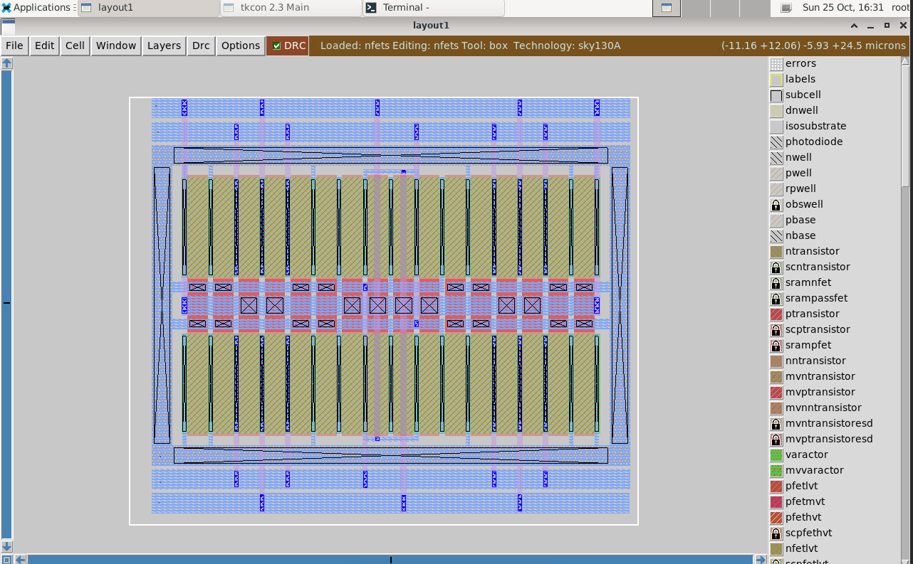
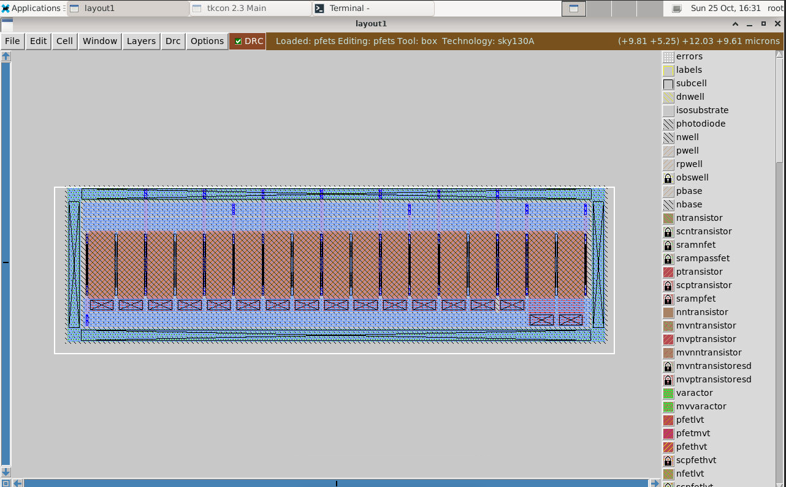
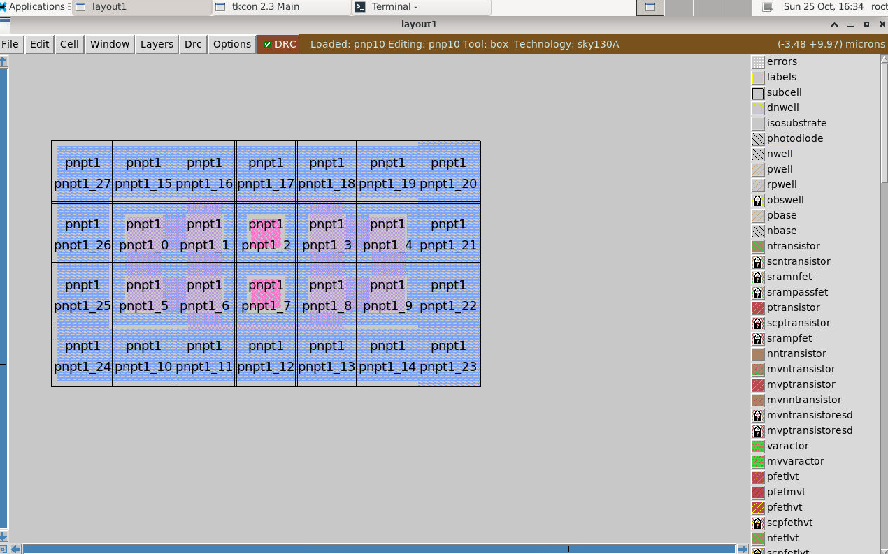
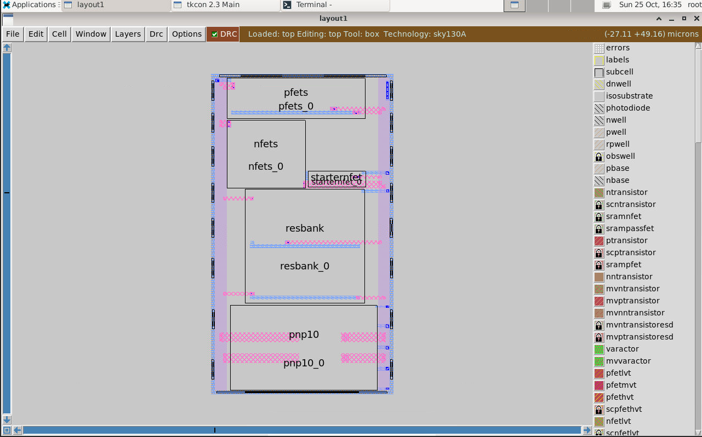

# Bandgap Reference (BGR) Design in SkyWater sky130

Design of a **self-biased current mirror (SBCM) bandgap voltage reference** in the Google/SkyWater **sky130** 130 nm PDK. The project covers theory, circuit design, pre-layout simulation (ideal and process corners), layout in Magic, and netlist extraction.

---

## Table of Contents

1. [Introduction](#1-introduction)
2. [Theory of Operation](#2-theory-of-operation)
3. [Self-Biased Current Mirror BGR Architecture](#3-self-biased-current-mirror-bgr-architecture)
4. [Circuit Design](#4-circuit-design)
5. [Pre-Layout Simulation](#5-pre-layout-simulation)
6. [Layout Design](#6-layout-design)
7. [Verification](#7-verification)
8. [Repository Structure and How to Reproduce](#8-repository-structure-and-how-to-reproduce)
9. [Summary](#9-summary)

---

## 1. Introduction

### 1.1 What is a bandgap reference?

A bandgap voltage reference is a circuit widely used in integrated circuits. It produces an almost constant voltage, close to the theoretical bandgap of the semiconductor, with very little variation over supply, load, time and temperature.

### 1.2 Why a BGR?

- **A battery** is unsuitable as a reference, because its voltage drops over time.
- **A typical power supply** is also unsuitable, because of noisy output and residual ripple.
- **A buried-Zener reference IC** has drawbacks:
  - The discrete design needs extra components and high-frequency filtering because of higher thermal noise.
  - Low-voltage Zener diodes are not available.

**Solution:** a bandgap reference can be integrated in bulk CMOS, BiCMOS or bipolar technologies without any external components.

### 1.3 Features

- Temperature-independent voltage reference, widely used in integrated circuits.
- Produces a constant voltage regardless of supply variation, temperature changes and circuit loading.
- Output voltage of about 1.2 V (close to the bandgap energy of silicon extrapolated to 0 K).
- Used across analog, digital, mixed-signal, RF and system-on-chip (SoC) designs.

### 1.4 Applications

- Low-dropout regulators (LDO)
- DC-to-DC buck converters
- Analog-to-digital converters (ADC)
- Digital-to-analog converters (DAC)

### 1.5 Types of BGR

**By architecture**

- Self-biased current mirror
- Operational-amplifier based

**By application**

- Low-voltage BGR
- Low-power BGR
- High-PSRR and low-noise BGR
- Curvature-compensated BGR

This project uses the **self-biased current mirror** architecture.

### 1.6 Tools and Environment

| Tool | Version | Purpose |
|------|---------|---------|
| Magic | 8.3.685 | Layout and DRC |
| Ngspice | 47+ | Circuit simulation |
| Netgen | 1.5.324 | LVS |
| PDK | sky130A | `/opt/pdk/sky130A/` |
| Platform | GitHub Codespaces (Ubuntu 22.04, noVNC desktop) | Development environment |

Based on the VSD bandgap workshop environment: <https://github.com/vsdip/vsd-bandgap>

---

## 2. Theory of Operation

### 2.1 BGR Principle

A BGR sums a voltage with a negative temperature coefficient (CTAT) and a voltage with a positive temperature coefficient (PTAT). Semiconductor diodes are CTAT: as temperature rises, the voltage across the diode falls. A PTAT circuit cancels that slope, so the sum stays constant over temperature.

<p align="center">
  
</p>

### 2.2 CTAT Voltage Generation

For a constant current through a forward-biased diode, the voltage falls with temperature. The slope of V vs temperature is typically about **-2 mV/°C**.

<p align="center">
  
</p>

### 2.3 PTAT Voltage Generation

The diode current equation has two temperature-dependent parts:

- **Thermal voltage V<sub>T</sub>**, directly proportional to temperature (order ~1).
- **Reverse saturation current I<sub>S</sub>**, which grows strongly with temperature (order ~2.5). Because I<sub>S</sub> sits in the denominator, ln(I<sub>0</sub>/I<sub>S</sub>) falls as temperature rises, which is what makes the diode CTAT.

<p align="center">
  
</p>

To get a PTAT voltage, V<sub>T</sub> has to be separated from I<sub>S</sub>. The circuit below does this with two branches carrying the same current I:

<p align="center">
  
</p>

Because the same current flows in both branches, nodes A and B are at the same voltage V. In branch B, subtracting V<sub>1</sub> from V leaves a term that depends on V<sub>T</sub> only:

<p align="center">
  
</p>

```
V      = combined voltage across R1 and Q2 (CTAT, shallower slope)
V1     = voltage across Q1 (CTAT, steeper slope)
V - V1 = voltage across R1 (PTAT)
```

The slope of V - V<sub>1</sub> is much smaller than the CTAT slope. To raise it, **N BJTs are used in parallel** as the diode, so the current per BJT is smaller and the difference between the two V<sub>BE</sub> values grows:

$$\Delta V_{BE} = V_T \ln N$$

<p align="center">
  
</p>

---

## 3. Self-Biased Current Mirror BGR Architecture

The SBCM-based BGR is built from five blocks:

1. CTAT voltage generation circuit
2. PTAT voltage generation circuit
3. Self-biased current mirror circuit
4. Reference branch circuit
5. Start-up circuit

### 3.1 CTAT Voltage Generation Circuit

A BJT connected as a diode, which shows the CTAT behaviour described in section 2.

<p align="center">
  
</p>

### 3.2 PTAT Voltage Generation Circuit

**N** BJTs connected with a series resistor. The operating principle is described in section 2.3.

<p align="center">
  
</p>

### 3.3 Self-Biased Current Mirror

A self-biased current mirror needs no external bias. It biases itself to the desired current without an external reference current.

<p align="center">
  
</p>

### 3.4 Reference Branch

The reference branch adds the CTAT and PTAT voltages to give the final reference voltage. It uses a mirror transistor and a BJT connected as a diode. Because of the mirror transistor, the same current flows in the reference branch as in the other branches.

The PTAT branch supplies the PTAT current, and the same current flows through the reference branch. The PTAT voltage slope is much smaller than the CTAT slope, so it has to be amplified. At constant current, V = I·R, so a larger resistance gives a larger voltage slope. Across this larger resistance plus the diode voltage, the output is the sum of the CTAT and PTAT voltages, which is the constant reference voltage:

$$V_{ref} = V_{BE3} + \frac{R_2}{R_1} V_T \ln N$$

<p align="center">
  
</p>

### 3.5 Start-Up Circuit

A self-biased mirror has two stable operating points, and one of them is the zero-current state. The start-up circuit pushes a small current through the mirror when the branch currents are zero. This small current disturbs the zero-current state, and the self-biased mirror then settles to its intended current.

<p align="center">
  
</p>

### 3.6 Complete BGR Circuit

Connecting all the blocks gives the complete BGR circuit.

<p align="center">
  
</p>

### 3.7 Advantages and Limitations

**Advantages of the SBCM BGR**

- Simplest topology
- Easy to design
- Always stable

**Limitations**

- Low power supply rejection ratio (PSRR)
- A cascode design is needed to improve PSRR
- Voltage headroom issue
- Needs a start-up circuit

---

## 4. Circuit Design

### 4.1 Design Requirements

<!-- TODO: the simulation netlists use a 2 V supply (vsup dc 2), while this requirement says 1.8 V. Make the two consistent. -->

| Parameter | Target |
|-----------|--------|
| Supply voltage | 1.8 V |
| Temperature range | -40 °C to 125 °C |
| Power consumption | < 60 µW |
| Off current | < 2 µA |
| Start-up time | < 2 µs |
| Temperature coefficient of V<sub>ref</sub> | < 50 ppm/°C |

### 4.2 Device Selection (from the PDK device data)

**MOSFET**

| Parameter | NFET | PFET |
|:-:|:-:|:-:|
| **Type** | LVT | LVT |
| **Voltage** | 1.8 V | 1.8 V |
| **Vt0** | ~0.4 V | ~-0.6 V |
| **Model** | `sky130_fd_pr__nfet_01v8_lvt` | `sky130_fd_pr__pfet_01v8_lvt` |

**BJT (PNP)**

| Parameter | PNP |
|:-:|:-:|
| **Current rating** | 1 µA - 10 µA per µm² |
| **Beta** | ~12 |
| **Emitter area** | 11.56 µm² |
| **Model** | `sky130_fd_pr__pnp_05v5_W3p40L3p40` |

**Resistor (high-resistance poly)**

| Parameter | RPOLYH |
|:-:|:-:|
| **Sheet resistance** | ~350 Ω |
| **Tempco** | 2.5 Ω/°C |
| **Bin widths** | 0.35 µ, 0.69 µ, 1.41 µ, 5.73 µ |
| **Model** | `sky130_fd_pr__res_high_po` |

### 4.3 Design Calculations

**1. Current budget**

- Maximum power consumption < 60 µW
- Maximum total current = 60 µW / 1.8 V = 33.33 µA
- 10 µA per branch is chosen (3 × 10 µA = 30 µA)
- Start-up current: 1 - 2 µA

**2. Number of BJTs in parallel in branch 2**

- Fewer BJTs need a smaller resistance, but matching suffers.
- More BJTs need a larger resistance, but give better matching.
- A moderate number is chosen: **8 BJTs**, for good layout matching and a moderate resistance value.

**3. Calculation of R1**

- R1 = V<sub>T</sub> · ln(8) / I = 26 mV · ln(8) / 10.7 µA ≈ **5 kΩ**
- R1 unit size: W = 1.41 µm, L = 7.8 µm, unit resistance about 2 kΩ
- Number of units needed: 2 in series + 2 in parallel (2 + 2 + (2 ‖ 2))

**4. Calculation of R2**

<!-- TODO: with k/q = 86 µV/°C the zero-slope condition gives R2/R1 of about 8.9 (R2 of about 45 kΩ). The 33 kΩ below corresponds to 115 µV/°C. Re-check the number used for the PTAT slope per unit ln(8). -->

- Current through the reference branch: I<sub>3</sub> = I<sub>2</sub> = V<sub>T</sub> · ln(8) / R1
- Voltage across R2: R2 · I<sub>3</sub> = (R2 / R1) · V<sub>T</sub> · ln(8)
- Slope of V<sub>R2</sub> = (R2 / R1) · ln(8) · (k/q) per °C
- Slope of V<sub>BE3</sub> (Q3) ≈ -1.6 mV/°C
- Adding both slopes and equating to zero gives R2 of about **33 kΩ**
- Number of units needed: 16 in series + 2 in parallel (2 + 2 + ... + (2 ‖ 2))

**5. SBCM design (self-biased current mirror)**

*A. PMOS in the SBCM*

- Both MP1 and MP2 are kept in saturation.
- L = 2 µm reduces channel-length modulation.
- Final size: **L = 2 µ, W = 5 µ, M = 4**

*B. NMOS in the SBCM*

- Both MN1 and MN2 are kept in saturation or deep sub-threshold. This design uses deep sub-threshold.
- L = 1 µm reduces channel-length modulation.
- Final size: **L = 1 µ, W = 5 µ, M = 8**

### 4.4 Final Circuit

<p align="center">
  
</p>

---

## 5. Pre-Layout Simulation

All simulations use ngspice with the sky130A models (`.lib ... sky130.lib.spice` with the corner name) and a temperature sweep of -40 °C to 125 °C. The netlists are in `bandgap/prelayout/`.

The temperature coefficient is calculated with the box method:

$$TC = \frac{V_{max} - V_{min}}{V_{nom} \cdot (T_{max} - T_{min})} \times 10^{6}\ \text{ppm/°C}$$

### 5.1 CTAT Simulation

The CTAT circuit is simulated in three cases.

**Case 1: constant current source and 1 BJT**

<p align="center">
  
</p>

<p align="center">
  
</p>

*Inference:* the output has a negative slope, as expected.

**Case 2: constant current source and 8 BJTs**

<p align="center">
  
</p>

<p align="center">
  
</p>

*Inference:* the slope is more negative than in case 1, because the current is divided among 8 BJTs.

**Case 3: variable current source and 1 BJT**

<p align="center">
  
</p>

<p align="center">
  
</p>

*Inference:* the slope becomes more negative as the bias current is reduced, which is equivalent to using more BJTs.

### 5.2 PTAT Simulation

To verify PTAT generation, a VCVS is used instead of the self-biased current mirror to force equal branch currents.

<p align="center">
  
</p>

The branch currents are equalized, and the current at 27 °C is 10.95 µA, which matches the branch current in the design calculation.

<p align="center">
  
</p>

<p align="center">
  
</p>

*Inference:* the PTAT voltage is generated by differencing two differently biased BJT branches, with a slope of about 86 µV/°C.

### 5.3 BGR with an Ideal Op-Amp

The op-amp is modelled as an ideal VCVS (`bgr_using_ideal_opamp.sp`). This case checks the CTAT and PTAT sum before the self-biased mirror is introduced.

<p align="center">
  
</p>

<p align="center">
  
</p>

*Inference:* a reference of about 1.2 V is produced, which corresponds to the bandgap of silicon.

<p align="center">
  
</p>

*Inference:* the ideal-op-amp BGR has a temperature coefficient of about **19 ppm/°C**, with the typical umbrella curve.

### 5.4 Non-Ideal Case: SBCM BGR over Process Corners

The ideal case works because the supply is a DC source. In a real circuit the supply ramps up, and a self-biased circuit has two stable states, of which the zero-current state is one. A start-up circuit is therefore needed to kick the circuit into its intended state.

Corner simulations of the full SBCM BGR (netlists `bgr_lvt_rpolyh_3p40*.sp`):

| Corner | V<sub>ref</sub> variation | V<sub>nom</sub> | TC (ppm/°C) |
|--------|---------------------------|-----------------|-------------|
| ff | 2 mV | 1.12 V | 10.8 |
| tt | 4 mV | 1.08 V | 22.4 |
| ss | 8 mV | 1.094 V | 44.3 |

**tt corner**

<p align="center">
  
</p>

**ff corner**

<p align="center">
  
</p>

**ss corner**

<p align="center">
  
</p>

### 5.5 Inference

- V<sub>ref</sub> follows the expected parabolic (umbrella) curve. The PTAT term from ΔV<sub>BE</sub> cancels the CTAT slope of V<sub>BE</sub> near the top of the curve, so the output is nearly flat over a 165 °C range.
- The temperature coefficient stays below 45 ppm/°C in all three corners. The ff corner is the most stable (about 10.8 ppm/°C) and the ss corner the least (about 44.3 ppm/°C).
- The nominal V<sub>ref</sub> shifts between corners, because device and resistor variation changes the bias current and the ΔV<sub>BE</sub> term.
- The cancellation is tuned at one corner, so it is not perfect at the others. Trimming the resistor ratio or using a curvature-compensated design would reduce the spread.

---

## 6. Layout Design

### 6.1 Layout Strategy

- **Common-centroid matching** is used for the resistors R1 and R2, so they are arranged symmetrically.
- **Dummy components** are added where needed to keep the layout symmetric.

### 6.2 Block Layouts (Magic)

**Resistor bank**

<p align="center">
  
</p>

**NFETs**

<p align="center">
  
</p>

**PFETs**

<p align="center">
  
</p>

**BJTs**

<p align="center">
  
</p>

### 6.3 Top-Level Layout

The `.mag` files of the nfets, pfets, bjts and top cells are shown here.

<p align="center">
  
</p>

### 6.4 Netlist Extraction

Commands in the Magic console to extract the netlist from the `.mag` file:

```
extract all
ext2sim label on
ext2sim
ext2spice scale off
ext2spice hierarchy off
ext2spice
```

This writes the `.ext`, `.sim`, `.nodes` and `.spice` files.

> **Note:** this command sequence produces a device-level netlist without parasitic R and C. To include parasitic capacitance, enable it before extraction (`extract do all`) and set `ext2spice cthresh 0` before running `ext2spice`.

---

## 7. Verification

> Replace each placeholder image below with your own screenshot. Save the screenshots in `Images/` using the file names shown, or change the names in the `` tags.

### 7.1 Extraction Output

After `extract all` and `ext2spice` in Magic, the top cell has these files: `top.mag`, `top.ext`, `top.spice`, `top.sim` and `top.nodes`. Only `top.spice` is used for LVS and for the extracted simulation.

<p align="center">
  
</p>

*Figure: extracted files of the top cell (placeholder).*

### 7.2 DRC (Design Rule Check)

In Magic, with the top cell loaded:

```
drc check
drc count
```

<p align="center">
  
</p>

*Figure: DRC result of the top cell (placeholder).*

| Item | Result |
|------|--------|
| DRC errors in `top` | *fill in* |

### 7.3 LVS (Layout vs Schematic)

**Inputs**

| Netlist | File | Source |
|---------|------|--------|
| Layout | `top.spice` | Extracted from `top.mag` with `ext2spice lvs` |
| Schematic | `top_schematic.spice` | Pre-layout BGR netlist wrapped as `.subckt top vdd gnd vref` |

The schematic netlist for LVS is prepared from the simulation deck:

- The `.lib`, `.global`, `.temp`, `.dc` and `.control` lines and the supply sources are removed.
- The zero-volt current-measurement sources (`vid1` to `vid5`) are removed, and each pair of nodes is merged into one net.
- The circuit is wrapped in `.subckt top vdd gnd vref` ... `.ends`, so the ports match the layout.

<p align="center">
  
</p>

*Figure: schematic netlist prepared for LVS (placeholder).*

**Commands**

```
# In Magic: LVS-friendly netlist
extract all
ext2spice lvs
ext2spice

# In the terminal: compare layout and schematic
netgen -batch lvs "top.spice top" "top_schematic.spice top" \
  /opt/pdk/sky130A/libs.tech/netgen/sky130A_setup.tcl comp.out
tail -30 comp.out
```

<p align="center">
  
</p>

*Figure: netgen run (placeholder).*

**Result**

A passing run ends with `Circuits match uniquely`.

<p align="center">
  
</p>

*Figure: LVS result (placeholder).*

| Check | Result |
|-------|--------|
| Device count (layout vs schematic) | *fill in* |
| Net count (layout vs schematic) | *fill in* |
| Final result | *fill in: match / mismatch* |

**Points checked while preparing LVS**

| Point | Observation | Resolution |
|-------|-------------|------------|
| Resistor bulk | The layout ties the poly-resistor bulk to `gnd` | *fill in: schematic bulk changed to `gnd`* |
| Resistor length | Extracted `l=7.96`, schematic `l=7.8` | *fill in* |
| Start-up pfet `xmp6` | The layout connects its source differently from the schematic | *fill in* |

<p align="center">
  
</p>

*Figure: mismatch report before and after the fix (optional placeholder).*

### 7.4 Post-Layout Simulation

The extracted `top.spice` is simulated in ngspice with a small testbench (`top_sim.sp`) that supplies power, sweeps temperature from -40 °C to 125 °C and measures the temperature coefficient:

```
.lib "/opt/pdk/sky130A/libs.tech/ngspice/sky130.lib.spice" tt
.include "top.spice"

xtop vdd vref 0 top
vsup vdd 0 dc 2
.dc temp -40 125 5
```

```
ngspice top_sim.sp
```

> This netlist has no parasitic R and C unless parasitic extraction was enabled (section 6.4), so it shows the effect of the layout's device sizes only.

<p align="center">
  
</p>

*Figure: V<sub>ref</sub> vs temperature, extracted netlist, tt corner (placeholder).*

<p align="center">
  
</p>

*Figure: pre-layout and post-layout V<sub>ref</sub> compared (placeholder).*

| Metric (tt corner, -40 °C to 125 °C) | Pre-layout | Post-layout (extracted) |
|--------------------------------------|------------|-------------------------|
| V<sub>ref</sub> variation | 4 mV | *fill in* |
| V<sub>nom</sub> | 1.08 V | *fill in* |
| TC (ppm/°C) | 22.4 | *fill in* |

**Inference:** *fill in after the simulation, for example how close the extracted result is to the pre-layout curve and what causes any difference.*

### 7.5 Verification Summary

| Check | Status |
|-------|--------|
| Extraction | Done |
| DRC | *fill in* |
| LVS | *fill in* |
| Post-layout simulation | *fill in* |

---

## 8. Repository Structure and How to Reproduce

### 8.1 Repository Structure

```
Bandgap_Circuit_Design/
├── .devcontainer/        # Codespaces environment (Magic, Ngspice, Netgen, sky130A)
└── bandgap/
    ├── Images/           # figures used in this README
    └── prelayout/        # ngspice netlists
```

**Pre-layout netlists (`bandgap/prelayout/`)**

| File | Content |
|------|---------|
| `ctat_voltage_gen.sp` | CTAT generation, 1 BJT |
| `ctat_voltage_gen_mul_bjt.sp` | CTAT generation, 8 BJTs |
| `ctat_voltage_gen_var_current.sp` | CTAT generation, variable current |
| `ptat_voltage_gen.sp`, `ptat_circuit.sp` | PTAT generation |
| `bgr_using_ideal_opamp.sp` | BGR with an ideal op-amp (VCVS) |
| `bgr_lvt_rpolyh_3p40.sp`, `_ff.sp`, `_ss.sp` | Full SBCM BGR, tt / ff / ss corners |
| `bgr_lvt_rpolyh_3p40_var_supply.sp` | Full SBCM BGR with supply variation |

### 8.2 How to Reproduce

1. Fork this repository and open it in a **GitHub Codespace** (Code → Codespaces → Create codespace on main).
2. In the terminal, run a simulation:
   ```
   cd /workspaces/Bandgap_Circuit_Design/bandgap/prelayout
   ngspice bgr_using_ideal_opamp.sp
   ```
3. For the Magic GUI, open the **PORTS** tab, click the forwarded URL of **noVNC Desktop (6080)**, choose `vnc_lite.html`, and start `magic` in the desktop terminal.
4. In the netlists, the corner is selected in the library line, with the corner name **outside** the quotes:
   ```
   .lib "/opt/pdk/sky130A/libs.tech/ngspice/sky130.lib.spice" tt
   ```
   Replace `tt` with `ff` or `ss` for the other corners.

---

## 9. Summary

| Requirement | Target | Result |
|-------------|--------|--------|
| Temperature range | -40 °C to 125 °C | Simulated over the full range |
| TC of V<sub>ref</sub> | < 50 ppm/°C | 10.8 (ff), 22.4 (tt), 44.3 (ss) ppm/°C |
| Power consumption | < 60 µW | To be verified |
| Off current | < 2 µA | To be verified |
| Start-up time | < 2 µs | To be verified |

The SBCM bandgap reference meets the temperature-coefficient target in all three process corners. LVS and post-layout simulation will complete the verification.

**Reference:** VSD bandgap workshop environment, <https://github.com/vsdip/vsd-bandgap>; SkyWater sky130 PDK.
