This github repository is for the design of a Band Gap Reference Circuit (BGR) using Google-skywater130nm technology PDK.

# Bandgap_Circuit_Design
A bandgap voltage reference circuit is a voltage reference circuit widely used in integrated circuits. It produces an almost constant voltage corresponding to the particular semiconductor's theoretical band gap, with very little fluctuations from variations of power supply, electrical load, time, temperature 


### Why BGR 
- A battery is unsuitable for use as a reference voltage source.
  - voltage drops over time
- A typical power supply is also not suitable 
  - noisy output and/or residual ripple.
- A voltage reference IC used buried Zener diode, 
  - Discrete design required additional components and high frequency filtering circuits due to higher thermal noise.
  - Low voltage Zener  diode is not available

**Solution**
- A Bangap reference which can be integrated in bulk CMOS, Bi-CMOS or Bipolar technologies without the use of  external components.

### Features of BGR
- Temp. independent voltage reference circuit widely used in Integrated Circuits
- Produces constant voltage regardless of power supply variation, temp. Changes and circuit loading
- Output voltage of 1.2v (close to the band gap energy of silicon at 0 deg kelvin)
- All applications starting from analog, digital, mixed mode, RF and system-on-chip (SoC).

### Applications of BGR
- Low dropout regulators (LDO)
- DC-to-DC buck converters
- Analog-to-Digital Converter (ADC)
- Digital-to-Analog Converter (DAC)


###  Types of BGR
Architecture wise BGR can be designed in two ways

- Using Self-biased current mirror  
- Using Operational-amplifier 

Application wise BGR can be categorized as
- Low-voltage BGR
- Low-power BGR
- High-PSRR and low-noise BGR
- Curvature compensated BGR

We are going to design our BGR circuit using Self-biased current mirror architecture.

###  Self-biased current mirror based BGR

The Self-biased current mirror based constitute of the following components.

- CTAT voltage generation circuit
- PTAT voltage generation circuit
- Self-biased current mirror circuit
- Reference branch circuit
- Start-up circuit

####  CTAT Voltage generation circuit
The CTAT Voltage generation circuit consist of a BJT connected as a diode, which shows CTAT nature as explained above.
<p align="center">
  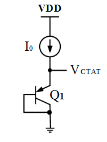
</p>

####  PTAT Voltage generation circuit
The PTAT Voltgae generation circuit consist of **N** BJTs connected with a series resistance. The operation principle is explained above.
<p align="center">
  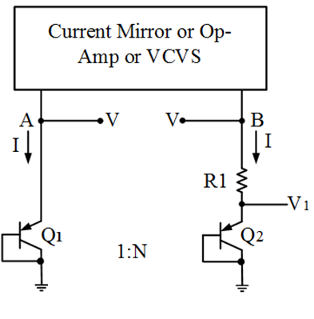
</p>

####  Self-Biased Current Mirror Circuit
The Self-biased current mirror is a type of current mirror which requires no external biasing. This current mirrors biases it self to the desired current value without any external current source reference. 
<p align="center">
  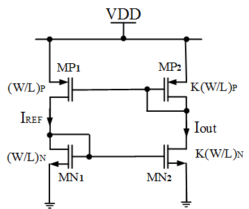
</p>

####  Reference Branch Circuit
The reference circuit branch performs the addition of CTAT and PTAT volages and gives the final reference voltage. We are using a mirror transitor and a BJT as diode in the reference branch. By virtue of the mirror transistor in the reference branch the same amount of current flows through it as of the current mirror branches. Now from the PTAT circuit branch we are getting PTAT voltage and PTAT current. The same PTAT current is flowing in the reference branch. But the slope of PTAT voltage is much more smaller than that of slope of CTAT voltgae. In order to make increase the voltage slope we have to increase the resistance (current constant, so V increases with increase in R). Now across the high resistance we will get our constant reference voltage which is the result of CTAT Voltage + PTAT Voltage.
<p align="center">
  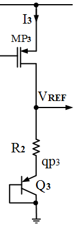
</p>

####  Start-up circuit
The start-up circuit is required to move out the self biased current mirror from degenerative bias point (zero current). The start-up circuit forecefully flows a slow amount of current through the self-biased current mirror when the current is 0 in the current mirror branches, as the current mirror is self biased this small current creats a disturbance and the current mirror auto biased to the desired current value.
<p align="center">
  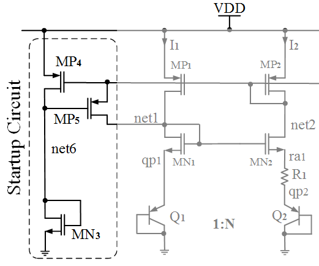
</p>

#### Complete BGR Circuit
Now by connecting all above components we can get the complete BGR circuit.
<p align="center">
  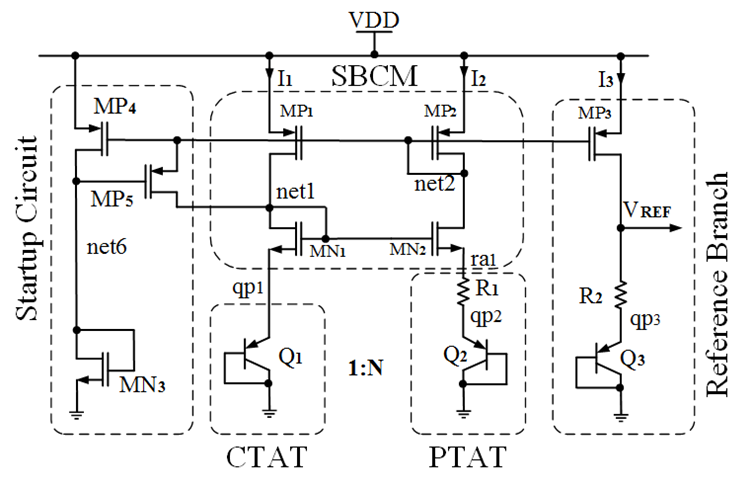
</p>
Advantages of SBCM BGR:

- Simplest topology
- Easy to design 
- Always stable

Limitations of SBCM BGR:

- Low power supply rejection ratio (PSRR)
- Cacode design needed to reduce PSRR
- Voltage head-room issue
- Need start-up circuit


### 1.1 Design Requirements
- Supply voltage = 1.8V
- Temperature: -40 to 125 Deg Cent.
- Power Consumption < 60uW
- Off current < 2uA
- Start-up time < 2us
- Tempco. Of Vref < 50 ppm

Now, we have to go through the device data sheet to find the appropriate devices for our design. 

After thoroughly going through the device data sheet we selected the following devices for our design.
### 1.2 Device Data Sheet
***1. MOSFET***
| Parameter | NFET | PFET |
| :-: | :-: | :-: |
| **Type** | LVT | LVT |
| **Voltage** | 1.8V | 1.8V |
| **Vt0** | ~0.4V | ~-0.6V |
| **Model** | sky130_fd_pr__nfet_01v8_lvt | sky130_fd_pr__pfet_01v8_lvt |

***2. BJT (PNP)***
| Parameter | PNP | 
| :-: | :-: | 
| **Current Rating** | 1uA-10uA/um2 | 
| **Beta** | ~12 |
| **Vt0** | 11.56 um2 | 
| **Model** | sky130_fd_pr__pnp_05v5_W3p40L3p40 |

***3. RESISTOR (RPOLYH)***
| Parameter | RPOLYH | 
| :-: | :-: | 
| **Sheet Resistance** | ~350 Ohm | 
| **Tempco.** | 2.5 Ohm/Deg Cent |
| **Bin Width** | 0.35u, 0.69u, 1.41u, 5.37u | 
| **Model** | sky130_fd_pr__res_high_po |

### 1.3 Circuit Design

**1. Current Calculation**

- Max. power Consumption < 60uW
- Max Total Current = 60 uW/1.8V=33.33uA
- So, we have chosen 10uA/branch, (3*10=30uA)
- Start-up current 1-2 uA

**2. Choosing Number of BJT in parallel in Branch2**
- Less number of BJT: require less resistance value but matching hampers
- More number of BJT: requires higher resistance value but gives good matching
- So a moderate number have chosen (8 BJT) for better layout matching and moderate resistance value.  

**3. Calculation of R1**
- R1= Vt* ln (8)/I =26 mv *ln(8)/10.7uA=5 KOhm
- R1 size: W=1.41um, L=7.8um, Unit res value: 2k Ohm
- Number of resistance needed: 2 in series and 2 in parallel (2+2+(2||2))

**4. Calculation of R2**
- Current through ref branch:I3=I2=Vt*ln(8)/R1
- Voltage across R2: R2*I3=R2/R1(Vt*ln(8))
- Slope of VR2= R2/R1 (ln(8)*115uv)/Deg Cent.
- Slope of VQ3=-1.6mV/Deg cent
- Adding both and equating to zero, R2 will be around 33k Ohm
- Number of resistance needed: 16 in series and 2 in parallel (2+2...+2+ (2||2))

**5. SBCM Design (Self-biased Current Mirror)**

***A. PMOS Design in SBCM***
- Make both the MP1 and MP2 well in Saturation 
- To reduce channel length modulation used L=2um
- Finally the size is **L=2u, W=5u and M=4**

***B. NMOS Design in SBCM***
- Make both the MN1 and MN2 either in Saturation or in deep sub-threshold
- We have made it in deep sub-threshold 
- To reduce channel length modulation used L=1um
- Finally the size is **L=1u, W=5u and M=8**


## 2. BGR Introduction

### 2.1 BGR Principle
The operation principle of BGR circuits is to sum a voltage with negative temprature coefficient with another one exhibiting opposite temperature dependancies. Generally semiconductor diode behave as CTAT i.e. Complement to absolute temp. which means with increase in temp. the voltage across the diode will decrease. So we need to find a PTAT circuit which can cancel out the CTAT nature i.e. with rise in temp. the voltage across that device will increase and thus we can get a constant voltage reference with respect to temp.
<p align="center">
  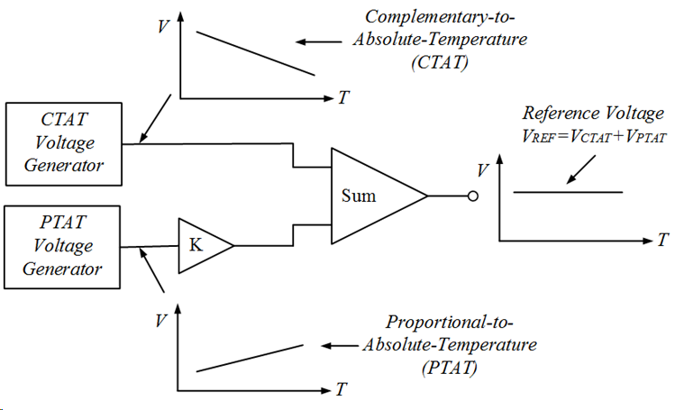
</p>

#### 2.1.1 CTAT Voltage Generation
Usually semiconductor diodes shows CTAT behaviour. If we consider constant current is flowing through a forwrard biased diode, then with increase in temp. we can observe that the voltage across the diode is decreaseing. Generally, it is found that the slope of the V~Temp is -2mV/deg Centigarde.
<p align="center">
  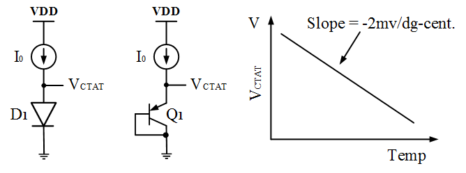
</p>


#### CTAT spice simulation

CTAT circuit is simulated under 3 cases 

Case 1 : Constant current source and 1 BJT

<p align="left">
  
</p>


<p align="right">
  
</p>


Inference: It produced a negative slope graph as expected


Case 2 : Constant current source and 8 BJT


<p align="left">
  
</p>


<p align="right">
  
</p>


Inference: It produced a more negative slope graph than case 1 as current is divided among 8 BJT.


Case 3 : Variable current source and 1 BJT


<p align="left">
  
</p>


<p align="right">
  
</p>


Inference: The slopes gets more negative as the biasing current is decreased, which is similar to increase in BJT.


#### 2.1.2 PTAT Voltage Generation
<p align="center">
  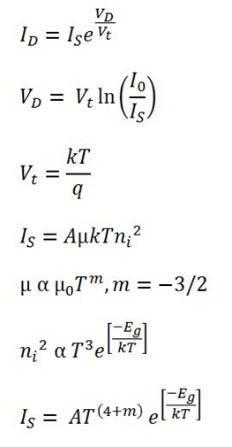
</p>

From Diode current equation we can find that it has two parts, i.e. 

- Vt (Thermal Voltage) which is directly proportional to the temp. (order ~ 1)
- Is (Reverse saturation current) which is directly proportional to the temp. (order ~ 2.5), as this Is term is in denominator so with increase in temp. the ln(Io/Is) decreases which is responsible for CTAT nature of the diode.

So to get a PTAT Voltage generation circuit we have to find some way such that we can get the Vt separated from Is.

To get Vt separated from Is we can approach in the following way
<p align="center">
  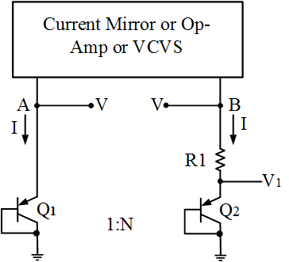
</p>

In the above circuit same amount of current I is flowing in both the branches. So the node voltage A and B are going to be same V. Now in the B branch if we substract V1 from V, we get Vt independent of Is.
<p align="center">
  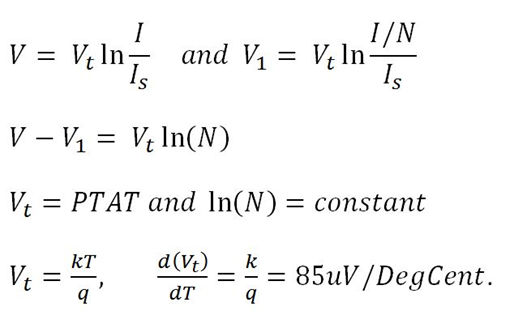
</p>
Now

```
V= Combined Voltage across R1 and Q2 (CTAT in nature but less sloppy)
V1= Voltage across Q2 (CTAT in nature but more sloppy)
V-V1= Voltage across R1 (PTAT in nature)
```
From above we can see that the voltage V-V1 is PTAT in nature, but it's slope is very less as compared to the CTAT, so we have to increase the slope. In order to increase the slope we can use multiple BJTs as diode, so that current per individual diode will be less and it the slope of V-V1 will increase.
<p align="center">
  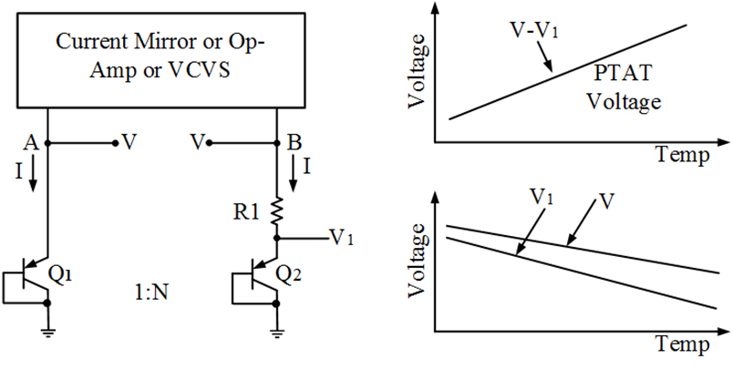
</p>

#### PTAT spice simulation

To verify the PTAT generation, instead of self-biasing current mirrors, VCVS is used to make the branch currents equeal

<p align="center">
  
</p>

The Image shows that the branch currents are equalized, and the current at 27 deg is 10.95 which is equal the branch current value in the design calculation.

<p align="center">
  
</p>


<p align="center">
  
</p>

Therefore, the PTAT is generated by differencing 2 differently biased BJT branches with a slope coefficient of 86 uV/deg C


#### Simulation of BGR with Ideal Opamp


<p align="center">
  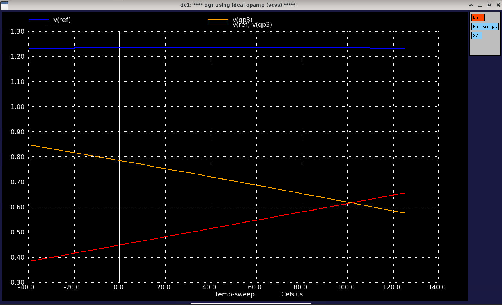
</p>

Inference: Voltage of 1.2v is produced at the end of the circuit, which is the silicon's bandgap


<p align="center">
  
</p>

Inference: The BGR based on Ideal Curve gave a accuracy of Approx 19 ppm/deg c Umbrella curve

#### Non- Ideal case

Ideal works fine as the input voltage is in DC mode, but in reality it is transition input. Self biased circuit are stable for 2 state in which zero current state are the most predominate state among them. In order to kick in the circuit initially a start up circuit is needed

## 3. Design and Pre-layout Simulation
For the real-time circuit design we are going to use sky130 technology PDK. Before we design the complete circuit we must know what are our design requirements. The design requirements are the design guidelines which our design must satisfy.


#### 3.3.1 Final Circuit
<p align="center">
  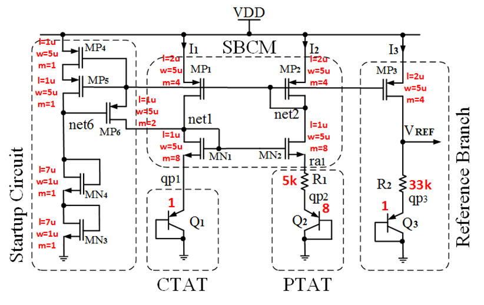
</p>

